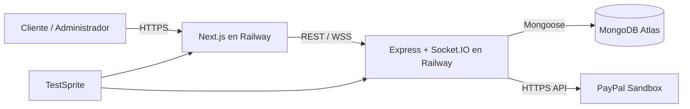

# Arquitectura de Lectora



## Límites de confianza

- El navegador presenta información y envía identificadores/cantidades, pero no es autoritativo para precios, stock, roles, pagos ni estados.
- El backend calcula totales desde MongoDB, valida sesiones, roles y propiedad, reserva stock y verifica la captura PayPal.
- Solo el backend conoce `MONGODB_URI`, `JWT_SECRET`, `PAYPAL_CLIENT_ID` y `PAYPAL_CLIENT_SECRET`.
- `NEXT_PUBLIC_API_URL` y `NEXT_PUBLIC_PAYPAL_CLIENT_ID` son valores públicos; nunca deben contener secretos.
- Socket.IO autentica el JWT y construye salas privadas de usuario o una sala administrativa. El cliente no elige salas.

## Datos

- `users`: identidad, hash, rol.
- `books`: producto, precio, stock, disponibilidad y formato.
- `orders`: snapshot comercial, contacto, total, estado, pago e historial.
- Los datos de PayPal permanecen asociados al pedido; no se guardan datos de tarjeta.

## Transiciones

```text
Pago: CREATED -> APPROVED -> CAPTURED
Pedido: PENDING_PAYMENT -> PAID -> PROCESSING -> READY_FOR_DELIVERY -> DELIVERED_DIGITALLY -> DELIVERED
```

Solo el administrador puede avanzar pedidos después de captura. La API rechaza saltos de estado.
